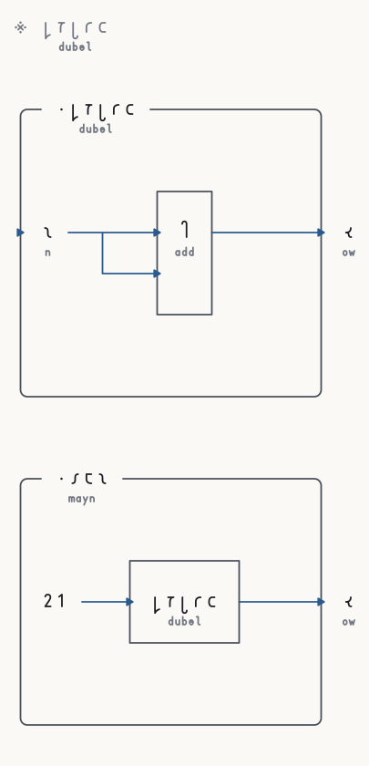

# Shawline

A dataflow programming language you draw. Definitions are rounded boxes, nodes that call them are square boxes, values flow along wires from sources to arrowheads, and every name is written in the [Shavian alphabet](https://en.wikipedia.org/wiki/Shavian_alphabet). The name in Shavian is `·𐑖𐑷𐑤𐑲𐑯` (shawlien).

**[Try it in your browser](https://fluffyrabbot.github.io/shawline/)**: Studio, the editor, opens with a tour. Nothing to install.

<p align="center">
  <a href="https://fluffyrabbot.github.io/shawline/#03-double">
    <picture>
      <source media="(prefers-color-scheme: dark)" srcset="docs/images/double-dark.svg">
      
    </picture>
  </a>
</p>

<details>
<summary>The same sheet as text</summary>

```
※ 𐑛𐑳𐑚𐑩𐑤

╭─ ·𐑛𐑳𐑚𐑩𐑤 ────────────╮
│                     │
│         ┌───┐       │
▶ 𐑯 ──┬───▶ 𐑐 ├───────▶ 𐑬
│     └───▶   │       │
│         └───┘       │
│                     │
╰─────────────────────╯

╭─ ·𐑥𐑱𐑯 ──────────────╮
│                     │
│       ┌───────┐     │
│ 21 ───▶ 𐑛𐑳𐑚𐑩𐑤 ├─────▶ 𐑬
│       └───────┘     │
│                     │
╰─────────────────────╯
```

</details>

The sheet above defines `·𐑛𐑳𐑚𐑩𐑤` (dubəl), which doubles a number: it feeds its input `𐑯` (n) into both inputs of `𐑐` (p, add) and sends the sum out at `𐑬` (ow). Rough ASCII sketches (`+--+`, `-->`) parse to the same program, and the formatter redraws them in canonical form.

**Who it's for.** Programmers who take Shawline as an art piece or a medium for drawing, don't read Shavian, and want to learn it as a hobby. You need no Shavian to start: every word carries its reading, how it sounds, spelled in letters you already know. The readings are meant to fade as you learn, and a switch turns them off.

**Why Shavian.** Each Shavian letter is one sound, and many letters come in mirrored pairs whose sounds pair up too: `𐑐` (p) and `𐑚` (b). Shawline names opposite operations with mirrored letters, so `𐑐` adds and its mirror `𐑚` subtracts, and `𐑤` (less than) mirrors `𐑮` (more than). Reading a program teaches the alphabet, and the shape of a letter tells you which operation is its opposite.

**Status.** The whole language works end to end: recognition of the drawing, checking, a bytecode VM, a formatter that keeps your layout, an SVG renderer, the Shawline Mono font, a language server and a VS Code extension. Studio, a web editor, opens with a tour and shows the value on each wire as you edit. The whole language can be drawn in it by mouse or keyboard: boxes, wires, constants and switches. It makes room when a move has none, extracts a selection into a new definition, and offers a fix for 18 kinds of diagnostic, most in one click. Next is sharing: a link that carries your own drawing, posters, and a gallery of sheets to remix. After that come challenges that teach the alphabet through its mirrored letters, with step-through runs ([docs/PLAN.md](docs/PLAN.md)). The language itself is specified in [docs/SPEC.md](docs/SPEC.md), whose §16 lists the words every surface uses.

## Prerequisites

- **Rust** 1.88 or later, through [rustup](https://rustup.rs). Everything below starts here.
- **Studio:** the `wasm32-unknown-unknown` target and `wasm-bindgen-cli` 0.2.126 (the version must match exactly), plus Python 3 to serve the page.
- **VS Code:** Node.js with npm, and VS Code 1.91 or later.

## Ways in

### Studio

Studio is published at <https://fluffyrabbot.github.io/shawline/>. To build and serve it yourself:

```bash
rustup target add wasm32-unknown-unknown
cargo install wasm-bindgen-cli --version 0.2.126
playground/build.sh
python3 -m http.server -d playground/dist
```

Open <http://localhost:8000>. The tour starts on a first visit and can be reopened from the Tour button.

### CLI

```bash
cargo run --bin shawline -- run corpus/08-factorial.shaw
```

`shawline --help` lists the commands: `check`, `run`, `fmt`, `render`, `diagram`, `ast` and `asm`.

`examples/` holds longer sheets outside the corpus. [gray-code.shaw](examples/gray-code.shaw) builds the reflected binary Gray code: `·𐑒𐑪𐑐𐑦` (copy) prefixes «0» to the shorter code, keeping its order, `·𐑥𐑦𐑮𐑼` (mirror) prefixes «1» to the reversed shorter code, and `·𐑕𐑐𐑧𐑤` (spell) joins each code's letters into one word with `𐑡`.

To read `.shaw` files in a terminal or another editor, the boxes only line up in a font that draws Shavian at the same width as box drawing. Build Shawline Mono with `cargo run -p shawline-font --example build -- ShawlineMono.ttf`, install it, and use it at line height 1.0.

### VS Code

`cargo install --path crates/shawline-lsp`, then `npm install && npm run package` in `editors/vscode/`, and install the `.vsix`. The extension ships Shawline Mono and offers to install it. See [editors/vscode/README.md](editors/vscode/README.md).

## License

The code is licensed under either of [MIT](LICENSE-MIT) or [Apache-2.0](LICENSE-APACHE), at your option. Shawline Mono is licensed under the [SIL Open Font License 1.1](crates/shawline-font/OFL.txt). The sheets in `corpus/` and `examples/` are licensed under [CC BY 4.0](https://creativecommons.org/licenses/by/4.0/): remix them, and credit The Shawline authors.
